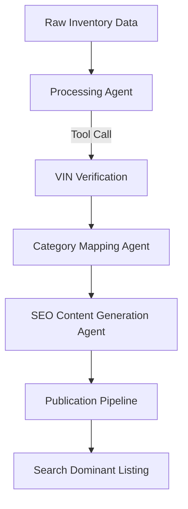

# J&P AutoHub 🚗
> **AI sales agent & SEO pipeline optimizing the e-commerce experience for auto parts.**


J&P AutoHub bridges the gap between massive automotive inventory datasets and user-friendly natural language queries. By employing a customized AI sales agent, it automatically processes SEO pipelines to optimize traffic acquisition, acting as an enterprise-grade solution for a Delaware-based auto parts hub.

### ✨ Key Features
- **Intelligent Sales Agent:** Handles customer parts queries via NLP.
- **Automated SEO Pipeline:** Auto-generates heavily optimized metadata, descriptions, and tags.
- **Inventory Vectorization:** Embeds complex part requirements for high-accuracy semantic search.
- **Dashboard Reporting:** Visualizes sales acquisition and workflow pipelines.
- **Cloud Infrastructure:** Entirely hosted with resilient scaling on AWS.

---

## 🏗️ Architecture



---

### 📺 Screenshots
> *[Placeholder: Insert an image/GIF of the web UI or SEO output here]*

---

### 🚀 Setup & Installation
```bash
# Clone the repository
git clone https://github.com/Alan-911/JP-autohub-project.git
cd JP-autohub-project

# Set up the environment
python -m venv venv
source venv/bin/activate
pip install -r requirements.txt

# Run the agent pipeline
python main.py
```
