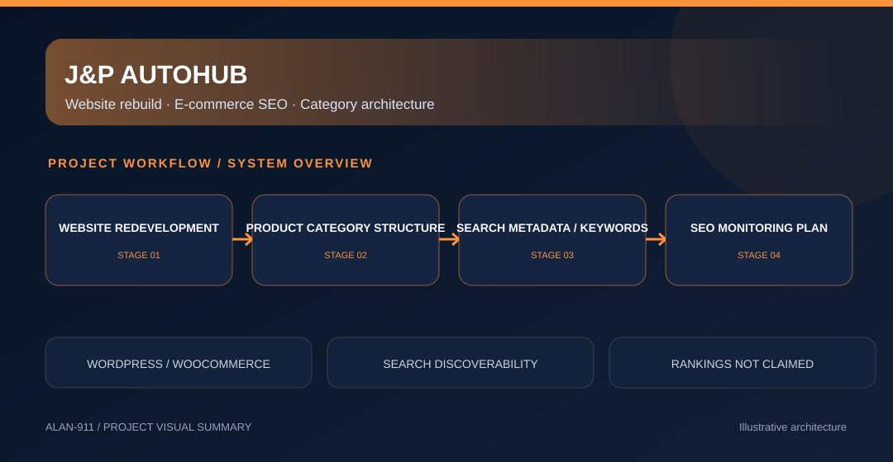

# J&P AutoHub — Website Rebuild & E-Commerce SEO

[](https://github.com/Alan-911/JP-autohub-project/actions/workflows/ci.yml)

**Website redevelopment · Technical SEO · Product taxonomy · WordPress / WooCommerce**

[Live website](https://jpautohub.com/) · [SEO action plan](SEO_Action_Plan.md) · [Keyword and metadata plan](Enhanced_SEO_Keywords.md) · [Category and URL plan](Categories_and_URLs.md)

## Website rebuild and SEO project overview



*Illustrative project-workflow graphic, not a screenshot of the live website or a measured SEO ranking outcome. [View the customer-facing site](https://jpautohub.com/).*

## Overview

J&P AutoHub is an automotive parts e-commerce website serving customers searching for replacement, OEM and salvage parts. My project work focused on **rebuilding and improving the customer-facing website** and developing a practical search-engine optimization strategy to make important pages, categories and inventory listings easier to discover.

The aim was to improve website presentation, search visibility and product discoverability—not to claim a guaranteed ranking position. Search rankings depend on competition, indexing, authority, relevance and ongoing optimization.

**Project scope:** website rebuild and SEO improvements, alongside an implementation plan for product categories, metadata, crawl controls and Google Search Console.

> **Evidence and scope:** This repository contains the SEO deliverables and supporting documentation, not the complete private WordPress/WooCommerce website source or hosting configuration. The live website is linked above. Actions described in checklists are proposed or verification-dependent unless supported by separate implementation evidence. No Google Search Console before/after ranking dataset is included.

## Workstreams and deliverables

| Area | Work | Public evidence |
| --- | --- | --- |
| Website redevelopment | Rebuilt and improved the J&P AutoHub web experience (project work described by the author) | [Live website](https://jpautohub.com/); source code not published here |
| Site architecture | Planned clear product categories and search-oriented URL structures | [Categories_and_URLs.md](Categories_and_URLs.md) |
| On-page SEO | Developed target keywords, category copy, product page titles and meta descriptions | [Enhanced_SEO_Keywords.md](Enhanced_SEO_Keywords.md) |
| Technical SEO | Documented crawl directives, sitemap conventions and exclusions for account/cart pages | [robots.txt](robots.txt) |
| Optimization rollout | Planned backup, duplicate-page review, redirects, sitemap submission and indexing checks | [SEO_Action_Plan.md](SEO_Action_Plan.md) |

## Search experience and information architecture

The SEO plan organizes salvage parts under a parent category and vehicle-make categories, with pages targeted at searches for used/OEM replacement parts. The documents also map specific salvage vehicles to proposed focus keywords, titles and descriptions.

```text
Customer search
    ↓
Search result and relevant landing page
    ↓
Product category / vehicle make
    ↓
Inventory and product details
    ↓
Enquiry / purchase
```

The live website is the deployed customer-facing result. The repository itself is a **website and SEO case-study archive**, not a standalone application to run via `python main.py`.

## Technical SEO checklist

The [action plan](SEO_Action_Plan.md) documents the intended process:

1. Back up the site before modifying URLs, plugins or content.
2. Review duplicate pages and add redirects when necessary.
3. Configure search-engine crawl rules and sitemap settings.
4. Organize categories and assign products appropriately.
5. Improve page titles, descriptions and internal navigation.
6. Submit and inspect important URLs in Google Search Console.
7. Monitor indexing, search queries and organic performance.

These items should be verified against the deployed WordPress configuration; a checked-in plan alone does not demonstrate completion.

## Measuring SEO outcomes

The goal is improved relevant discovery in search engines. A future case study can add **verified before/after measurements**, including:

- Google Search Console impressions, clicks, CTR and average search position.
- Indexed category and product pages, crawl errors and redirects.
- Organic landing-page traffic and relevant product enquiries.
- Core Web Vitals and mobile usability results.

**No independently verified ranking improvement or traffic-growth percentage is claimed in this repository.** Rankings for specific queries should be documented with dates, target regions and Search Console evidence.

## Repository contents

```text
Categories_and_URLs.md     Category hierarchy and suggested URL slugs
Enhanced_SEO_Keywords.md   Category/product keyword and metadata proposals
SEO_Action_Plan.md         WordPress/WooCommerce optimization checklist
robots.txt                 Proposed crawl directives and sitemap location
README.md                  Scope, evidence, approach and limitations
```

## Limitations and next steps

- The WordPress theme, plugins and site-specific implementation are not versioned in this repository.
- SEO recommendations must be checked against actual inventory availability and business policies before publication.
- Search-performance results require access to analytics and Search Console data.
- Add approved, redacted before/after screenshots and search performance reports when available.
- Remove or revise metadata that overstates inventory testing, warranties, fitment or shipping if not confirmed by the business.

## Author

**Yves Alain Iragena** · [Portfolio](https://alan-911.github.io/my-portfolio/) · [GitHub](https://github.com/Alan-911)


## Repository quality and security

- [Continuous integration](.github/workflows/ci.yml).
- [Security reporting policy](SECURITY.md) and [contribution guidelines](CONTRIBUTING.md).
- The workflow verifies case-study document structure, not website security or Google search rankings.
- Licensing for reuse should be confirmed with the project owner; no new license is granted by these workflow updates.
